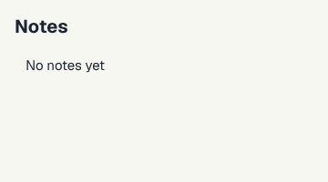
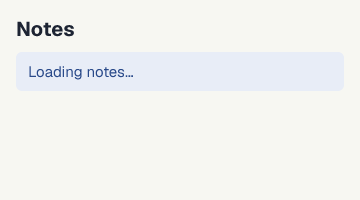
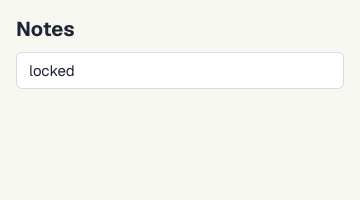
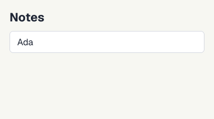
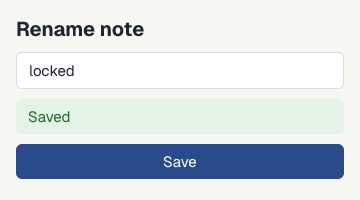
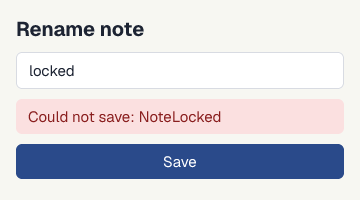

# @highalch/examples: bugs a story catches

A private workspace package (never published). Each example is one story run against two variants
of a view, machine or form: a **broken** one, which
the story catches with a readable failure, and an **approved** one, which passes. Both variants'
frames are reviewed baselines under [`baselines/takumi/`](tests/baselines/takumi), so the screen a user
would have seen sits next to the fixed one. The components and machines are exported, so other
tests can use them as fixtures.

Run them with the rest of the suite (`vp test --maxWorkers=2`), or alone:
`vp test packages/examples`. `UPDATE_SCREENS=1` rewrites the baselines; open the changed
PNGs before committing them. The run's filmstrips land in `packages/examples/artifacts/` (ignored).

| File                                                         | What                                                                                  |
| ------------------------------------------------------------ | ------------------------------------------------------------------------------------- |
| [`src/shared.ts`](src/shared.ts)                             | The runner (`LowAlchDb.memory` over the Notebook Domain), seeding, the screen factory |
| [`src/empty-while-loading.tsx`](src/empty-while-loading.tsx) | `BrokenNoteList` / `ApprovedNoteList`                                                 |
| [`src/sticky-optimistic.tsx`](src/sticky-optimistic.tsx)     | `BrokenTitles` / `ApprovedTitles`                                                     |
| [`src/swallowed-rejection.tsx`](src/swallowed-rejection.tsx) | `brokenEditor` / `approvedEditor`, their atoms, `EditorView`                          |
| [`src/reset-on-submit.tsx`](src/reset-on-submit.tsx)         | `renameForm`, `BrokenRenameForm` / `ApprovedRenameForm`                               |
| [`tests/examples.test.tsx`](tests/examples.test.tsx)         | The three stories, each run against both variants                                     |

## 1. The list claims to be empty while it loads

The broken list reads `result.data` and treats "no rows yet" as "no notes". `Story.hold()` keeps
the first query answer back, so the frame after `render` shows the list before its data arrives.

| Broken (frame 4)                                                     | Approved (frame 4)                                                     |
| -------------------------------------------------------------------- | ---------------------------------------------------------------------- |
|  |  |

```
Step 5 (check does not claim the list is empty while it loads) failed:
  the list says 'No notes yet' before its first answer arrived
```

The fix is to render every state of the live query (`LowAlch.match(result).on({ Loading, … })`),
as the fixture `NoteList` does.

## 2. A rejected rename stays on screen

The broken row remembers the optimistic title it saw while the rename was pending. The server
rejects the rename (`NoteLocked`), and `Db.then` shows the collection rolled back to "Ada", so the
bug is in the view: it still says "locked".

| Broken (after the rollback)                                                                   | Approved (after the rollback)                                                                   |
| --------------------------------------------------------------------------------------------- | ----------------------------------------------------------------------------------------------- |
|  |  |

```
Step 6 (check shows the title the server kept) failed:
  the screen shows "locked" after the rename was rejected
```

The fix is to render what the collection holds now (`note.title`), with `$hasPendingWrites` for
the pending badge.

## 3. A rejected save says "Saved"

The broken editor machine sends every end of the rename to `Saved`, rejections included, so the
user is told their change is safe while TanStack DB has rolled it back.

| Broken (after the rejection)                                                      | Approved (after the rejection)                                                      |
| --------------------------------------------------------------------------------- | ----------------------------------------------------------------------------------- |
|  |  |

```
Step 7 (machine is "Failed") failed: editor (mounted) is not in the expected state
  expected "Failed" {"problem":"NoteLocked"}
  observed "Saved" {"NoteId":"n1","draft":"locked"}
```

The fix is to send the typed rejection to `Failed`, as the fixture `editor` does:
`onError` reads `rejection(event.error)`.

## 4. A rejected rename loses what the user typed

The broken form resets itself as soon as it submits, so after the server rejects the title the
user's draft is gone. No hand-written story finds it here: an exploration does. It types into the
form (`Form.typing(renameForm, …)`), submits and settles in every order up to three moves, with the
rule "a rejected rename keeps what you typed" (see `packages/story/tests/forms.transition.test.tsx`).
It fails with the shortest sequence:

```
typing.step({"field":"title","instance":0,"value":"locked"}), submit.step(), settle.step()
```

The fix is to keep the draft until the rename commits.

Import the examples by their package name: `import { SwallowedRejection } from "@highalch/examples"`.
